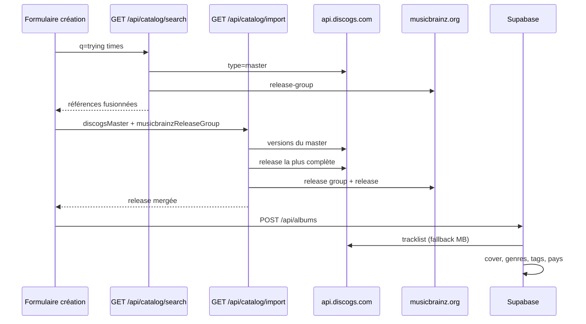

# APIs catalogue — Discogs, MusicBrainz et traitement des données

Ce document décrit comment LIBRARY interroge les sources externes, fusionne leurs métadonnées et persiste le résultat en base.

## Vue d'ensemble

LIBRARY ne dépend pas d'une seule API musicale. Chaque source a un rôle complémentaire :

| Source | Rôle principal | Unité de recherche |
|--------|----------------|-------------------|
| **Discogs** | Pressages physiques, formats, styles, notes, images, stats communauté | **Master** (= référence principale) puis **Release** (édition choisie) |
| **MusicBrainz** | Identité normalisée, dates, crédits, barcodes, pays ISO | **Release group** (= œuvre) puis **Release** (édition choisie) |

Le flux utilisateur sur `/bibliotheque/nouveau` :

1. **Recherche** → références principales (pas une liste de 10 vinyles identiques)
2. **Import** → sélection automatique de l'édition la plus complète + fusion Discogs/MB
3. **Formulaire** → pré-remplissage éditable
4. **Enregistrement** → persistance Supabase + tracklist + pochette + IDs externes



---

## Variables d'environnement

| Variable | Obligatoire | Description |
|----------|-------------|-------------|
| `DISCOGS_TOKEN` | Oui* | Token personnel Discogs (recommandé) |
| `DISCOGS_CONSUMER_KEY` + `DISCOGS_CONSUMER_SECRET` | Oui* | Alternative OAuth Discogs |
| `DISCOGS_USER_AGENT` | Recommandé | User-Agent explicite (ex. `MINO-Library/1.0 +https://mino.co`) |
| `MUSICBRAINZ_USER_AGENT` | Recommandé | User-Agent obligatoire côté MusicBrainz |

\* Discogs : token **ou** paire key/secret.

MusicBrainz : pas de clé API pour la lecture. Limite stricte : **1 requête / seconde** (gérée dans `lib/catalog/musicbrainz/client.ts`).

---

## Routes API internes (Next.js)

Toutes les routes catalogue requièrent un utilisateur authentifié (domaines `mino.co`, `imagine-nation.co`).

### Recherche unifiée

```
GET /api/catalog/search?q={query}
```

Interroge en parallèle :

- Discogs `database/search?type=master` — références principales
- MusicBrainz `release-group` — filtré sur les albums (`primarytype:album`)

Les résultats sont **dédoublonnés** par titre + artiste (`lib/catalog/merge-catalog-search.ts`).

Réponse :

```json
{
  "results": [
    {
      "key": "discogs-master:123",
      "title": "Trying Times",
      "artist": "James Blake",
      "subtitle": "Référence principale · Discogs + MusicBrainz · 2026",
      "year": "2026",
      "thumbUrl": "https://...",
      "discogsMasterId": 123,
      "musicbrainzReleaseGroupId": "uuid-...",
      "variantCount": null
    }
  ]
}
```

### Import / pré-remplissage

```
GET /api/catalog/import?discogsMaster={id}&musicbrainzReleaseGroup={uuid}
GET /api/catalog/import?discogsRelease={id}
GET /api/catalog/import?musicbrainzReleaseGroup={uuid}
```

Paramètres (au moins un requis) :

| Paramètre | Effet |
|-----------|-------|
| `discogsMaster` | Récupère les versions du master, choisit la release la plus complète, merge avec MB |
| `musicbrainzReleaseGroup` | Choisit la release MB la plus complète, tente de lier Discogs (URL ou barcode) |
| `discogsRelease` | Import direct d'une release Discogs (legacy / fallback) |

Réponse :

```json
{
  "release": { "...": "CatalogReleaseImport" },
  "sources": { "discogs": true, "musicbrainz": true },
  "variantCount": 12
}
```

### Enregistrement album

```
POST /api/albums
```

Corps JSON : champs du formulaire (`title`, `artist`, `country`, `discogsReleaseId`, `musicbrainzReleaseId`, etc.).

Effets secondaires à la création :

- Upload pochette depuis URL Discogs/Cover Art Archive → bucket Supabase
- Insertion tracklist (Discogs en priorité, MusicBrainz en fallback, durées complétées)
- Sync genres, sous-genres, tags
- Résolution pays → `origin_country_code` (table `countries`, création auto si absent)

### Autres routes Discogs (legacy)

| Route | Usage |
|-------|-------|
| `GET /api/catalog/discogs/search` | Recherche Discogs brute (releases/masters) — conservée, non utilisée par l'UI actuelle |
| `GET /api/catalog/discogs/releases/[id]` | Import release Discogs seule + merge MB heuristique |

### Lecture stats Discogs (fiche album)

Sur `/bibliotheque/[id]`, si `external_ids.discogs` est présent :

- Appel `fetchDiscogsCommunityStats` → note communauté, collection, wantlist
- Affichage via `DiscogsCommunityRating` (enrichissement lecture seule, pas à l'import)

### Resynchronisation tracklist

```
POST /api/albums/{id}/sync-tracks
```

Re-fetch Discogs + MusicBrainz, remplace `album_tracks` (titres, durées, writers, producers) et met à jour `track_count` / `total_duration_seconds`. Nécessite `external_ids.discogs` ou `external_ids.musicbrainz`.

- Bouton **Resynchroniser** sur la fiche album
- Batch : `pnpm db:sync-tracks -- --all` (requiert `SUPABASE_SERVICE_ROLE_KEY`)

---

## Règles de fusion Discogs + MusicBrainz

Implémentées dans `lib/catalog/merge-catalog-import.ts`.

| Champ | Priorité | Notes |
|-------|----------|-------|
| Titre, artiste | MusicBrainz | Normalisation plus fiable |
| Dates (année, date exacte) | MusicBrainz | Précision souvent meilleure |
| Genre, sous-genre | Discogs | Styles Discogs plus granulaires pour les filtres |
| Label | MusicBrainz | |
| Maison de disques | Discogs | |
| Producteurs | MusicBrainz | Relations structurées (`artist-rels`) |
| Pays | Discogs si précis, sinon MB | `Worldwide` / `Europe` ignorés au profit d'un pays ISO |
| Format (vinyle, CD…) | Discogs | MB ne distingue pas toujours le pressage physique |
| Description | Discogs + MB | Concaténation si les deux diffèrent |
| Pochette | Discogs → Cover Art Archive | URL CAA : `coverartarchive.org/release/{mbid}/front` |
| Track count | Max(Discogs, MB) | |
| Certification | Notes uniquement | Parsing Or/Platine/SNEP/RIAA dans les notes — pas de champ structuré |

### Liaison MusicBrainz lors de l'import Discogs

Ordre de recherche (`lib/catalog/musicbrainz/find-release.ts`) :

1. Barcode Discogs → `barcode:{upc}`
2. URL Discogs → `url:"discogs.com/release/{id}"`
3. Recherche Lucene titre + artiste + année

Si un `musicbrainzReleaseGroupId` est déjà connu (résultat de recherche fusionné), on prend directement la meilleure release du groupe.

---

## Sélection de l'édition la plus complète

Quand l'utilisateur choisit une **référence principale**, l'app ne prend pas un pressage au hasard.

### Discogs (master)

1. `GET /masters/{id}/versions` (jusqu'à 25 éditions)
2. Score par édition (`lib/catalog/score-release-completeness.ts`) : pays, label, format, barcode, tracklist, notes…
3. Bonus pour `main_release`
4. Malus pour pays vagues (`Worldwide`, `Europe`…)

### MusicBrainz (release group)

1. `GET /release?release-group={mbid}` (jusqu'à 25 releases)
2. Score : pays, barcode, label, statut official, track count, tags

---

## Pays et table `countries`

Le pays saisi (formulaire ou import) passe par :

1. `resolveCountryCode` — alias Discogs + noms ISO FR/EN (`Intl` + liste ISO 3166)
2. `resolveOriginCountryCode` — vérifie la table `countries`, **insère si absent**
3. Stockage dans `albums.origin_country_code` (FK)

Le seed `supabase/seed/lookups.sql` n'est qu'un **amorçage** (France, US, UK…). La table évolue avec les albums importés.

Libellés spéciaux :

| Entrée Discogs | Code | Affichage |
|----------------|------|-----------|
| Worldwide, World | XW | Monde |
| Europe, EU | XE | Europe |
| UK | GB | UK |

---

## Identifiants externes

Colonne `albums.external_ids` (jsonb) :

```json
{
  "discogs": 12345678,
  "musicbrainz": "c76c4b8e-6efc-421e-b301-b6208dae47d6"
}
```

Permet de relier la fiche aux sources sans migration à chaque nouvel ID.

---

## Fichiers clés

| Zone | Chemin |
|------|--------|
| Client Discogs | `lib/catalog/discogs/client.ts` |
| Mapping release Discogs | `lib/catalog/discogs/map-release.ts` |
| Pick best release (master) | `lib/catalog/discogs/pick-best-release.ts` |
| Client MusicBrainz | `lib/catalog/musicbrainz/client.ts` |
| Recherche release groups | `lib/catalog/musicbrainz/search-release-groups.ts` |
| Pick best release (group) | `lib/catalog/musicbrainz/pick-best-release.ts` |
| Fusion imports | `lib/catalog/merge-catalog-import.ts` |
| Orchestration import | `lib/catalog/build-merged-catalog-import.ts` |
| Fusion résultats recherche | `lib/catalog/merge-catalog-search.ts` |
| Pays / ISO | `lib/catalog/country-code.ts`, `lib/catalog/iso-country-codes.ts` |
| Persistance album | `lib/catalog/db/albums.ts` |
| Crédits piste | `lib/catalog/track-credits.ts`, `lib/catalog/discogs/fetch-tracks.ts`, `lib/catalog/musicbrainz/fetch-tracks.ts` |
| UI import | `app/bibliotheque/_components/album-create-form.tsx` |

---

## Limites connues

| Sujet | Détail |
|-------|--------|
| **Certification** (Or, Platine) | Rarement structurée chez Discogs/MB ; détectée seulement dans les notes |
| **Spotify** | Non utilisé — genres absents, pas de format physique, pas de crédits producteurs |
| **Rate limit MusicBrainz** | 1 req/s → import d'une référence peut prendre quelques secondes |
| **Pays vagues Discogs** | `Worldwide` remplacé par un pays ISO quand MusicBrainz ou une autre édition Discogs est plus précise |
| **Doublons catalogue** | Pas de détection de doublons à la création (prévu brief v1.1) |
| **Crédits piste** | Writers via MusicBrainz (works), producers via Discogs (extraartists piste) ; complétés par MB si disponible |
| **Wikipedia** | Non utilisé pour les crédits (données non structurées) |

---

## Schéma base de données

Voir [supabase/schema/README.md](../supabase/schema/README.md) pour le modèle relationnel (albums, lookups, `external_ids`, recherche plein texte).
