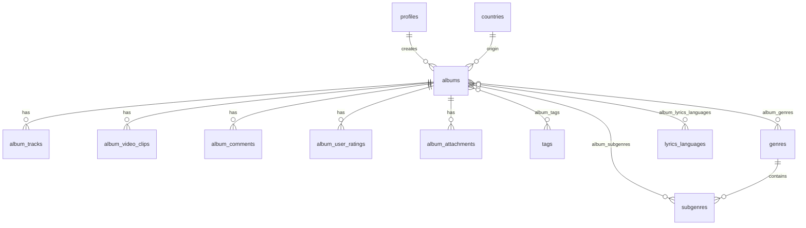

# Schéma LIBRARY (PostgreSQL / Supabase)

Modèle relationnel aligné sur le brief v1.1 : catalogue d’albums, tags, commentaires horodatés, pièces jointes, filtres multi-critères et métadonnées d’import (scraping).

## Principes

- **Une table = un fichier** (évolution indépendante, revue ciblée).
- **Lookups normalisés** (`genres`, `subgenres`, `tags`, `countries`, `lyrics_languages`) pour des filtres cohérents.
- **Relations N–N** via tables de liaison (`album_*`) quand une fiche peut avoir plusieurs valeurs.
- **Enfants 1–N** pour tracklist, clips, commentaires, pièces jointes.
- **`external_ids` (jsonb)** sur `albums` pour les IDs Discogs / MusicBrainz / etc. sans migration à chaque source.
- **Recherche plein texte** via `search_vector` + index GIN sur `albums`.

## Appliquer en CLI (recommandé)

Prérequis : `supabase login` puis `supabase link` depuis la racine du repo.

```bash
chmod +x supabase/apply_schema.sh
./supabase/apply_schema.sh --linked
```

Les fichiers SQL sont **idempotents** (`IF NOT EXISTS`, policies recréées) : tu peux relancer `pnpm db:schema` sans reset si une partie est déjà en place.

Si une application a échoué à mi-chemin (`relation "profiles" already exists`) :

```bash
pnpm db:schema:reset
```

Cela exécute `drop_schema.sql` puis réapplique tout le schéma.

La commande est **`supabase db query`** (pas `db execute`, supprimée dans les CLI récentes) :

```bash
supabase db query --linked -f supabase/schema/profiles.sql
```

## Ordre d’application (SQL Editor)

Exécuter dans le SQL Editor Supabase (dans cet ordre) :

1. `set_updated_at.sql`
2. `profiles.sql`
3. `countries.sql`
4. `lyrics_languages.sql`
5. `genres.sql`
6. `subgenres.sql`
7. `tags.sql`
8. `albums.sql`
9. `album_tracks.sql`
10. `album_video_clips.sql`
11. `album_tags.sql`
12. `album_genres.sql`
13. `album_subgenres.sql`
14. `album_lyrics_languages.sql`
15. `album_comments.sql`
16. `album_user_ratings.sql`
17. `album_attachments.sql`
17. `album_search.sql`

Puis : `../storage/album_attachments.sql` et `../storage/album_covers.sql` (buckets Storage).

Auth domaine : `../auth_custom_domain.sql` (déjà présent).

## Diagramme (simplifié)



## Évolutions prévues (sans casser le modèle)

- Cache scraping : table `album_import_runs` ou colonnes dédiées — `external_ids` suffit en V1.
- Rôles / permissions : colonne `role` sur `profiles` + policies RLS affinées.
- Import CSV en masse : job table + statut par ligne.
- Couverture album : `cover_storage_path` + bucket public `album-covers` (import depuis Discogs à la création).
